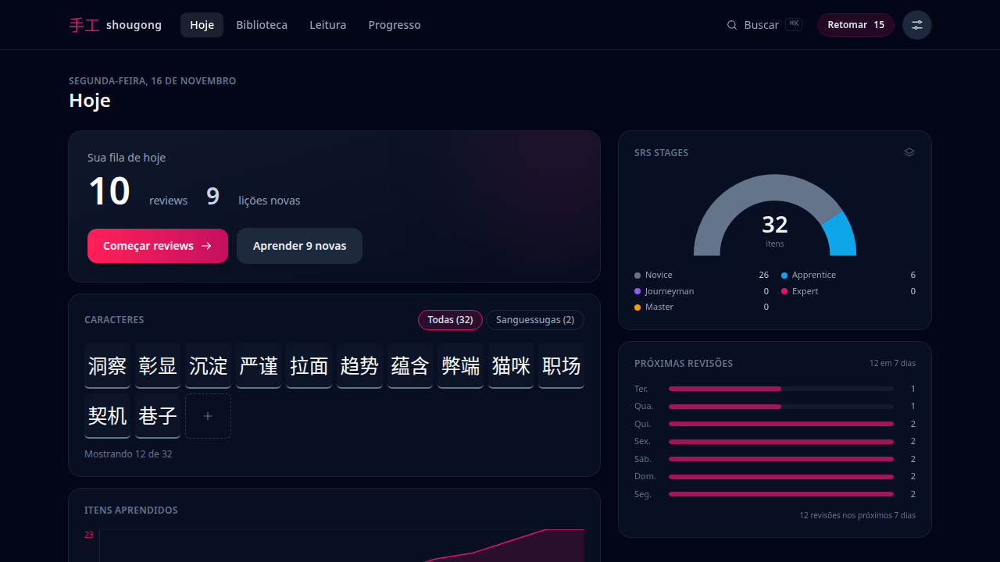

# shougong

A handwriting-first Chinese trainer for self-learners: FSRS-scheduled character practice plus vocabulary-constrained AI reading.



## Quickstart

Prerequisites: Docker with a running daemon, `uv` (Python 3.12+), and Node 22 + npm.

```bash
npm run setup
```

Start MySQL and the API:

```bash
npm run db
npm run db:migrate
npm run be:run
```

In a second shell, start the SPA:

```bash
npm run fe:dev
```

The app opens at <http://localhost:8133/>. The API listens on `:8130`, MySQL on `:8132`, and the combined image serves the SPA on `:8131`. A gitignored `.env` may override a host port; the committed defaults apply to a fresh clone.

## Checks

```bash
npm run be:check
```

```bash
npm run be:test
```

```bash
npm run fe:check
```

```bash
npm run fe:build
```

```bash
npm run check
```

`npm run be:check` runs backend lint, format-check, `mypy --strict`, import contracts and unit tests; `npm run fe:check` runs the frontend typecheck, lint and tests. The canonical all-checks command mirrors the pre-commit hooks, including the Docker-backed integration suite:

```bash
npm run be:check && npm run be:test && npm run fe:check
```

`npm run check` is the no-Docker convenience: backend check, frontend check and the production build.

## Limits

- AI reading generation needs an external LiteLLM gateway; the Quickstart does not start it, so the Leitura screen's generation stays unavailable until one is reachable. Its address is in [`backend/.env.example`](backend/.env.example).
- The combined image boots as a production profile, so it needs an OTLP endpoint; publishing it needs Docker Hub credentials. See the [deploy runbook](docs/runbooks/deploy.md).
- Acceptance needs Docker and the free `8130`–`8133` port block; the bootstrap-only steps and the fold-aware visual rule are in the [acceptance runbook](docs/runbooks/acceptance.md).
- The social preview is a manual upload: a 1280×640 crop of the primary screenshot, set once from the repository settings page.

## Docs

- [Code map](docs/code-map.md) — open it when you need the module, seam or entry-point map.
- [Repository conventions](AGENTS.md) — open it when you need the surface, run story or agent rules.
- [Domain glossary](CONTEXT.md) — open it when a domain term is unclear.
- [Backend conventions](backend/AGENTS.md) — open it before touching the backend.
- [Coding standards — Python lane](backend/CODING_STANDARDS.md) — open it when writing backend idiom-sensitive code.
- [Code map — backend](backend/docs/code-map.md) — open it for the backend's exhaustive module and seam index.
- [Observability — logging & metrics](backend/docs/observability.md) — open it before emitting or configuring telemetry.
- [Frontend conventions](frontend/AGENTS.md) — open it before touching the frontend.
- [Coding standards — React lane](frontend/CODING_STANDARDS.md) — open it when writing frontend idiom-sensitive code.
- [Code map — frontend](frontend/docs/code-map.md) — open it for the frontend's exhaustive module and seam index.
- [Business Overview](docs/01-business.md) — open it for the product intent, personas and workflows.
- [Technical Architecture](docs/02-architecture.md) — open it for the hexagonal layering, component inventory and configuration.
- [Data Model](docs/03-data-model.md) — open it before changing the schema or reading the FSRS fields.
- [HTTP API Reference](docs/04-api.md) — open it when adding or consuming an endpoint.
- [Reading Engine](docs/05-reading-engine.md) — open it before changing reading generation or its prompt.
- [UI / UX Spec — Responsive Redesign](docs/06-ui-ux-proposal.md) — open it for the responsive information architecture and interaction patterns.
- [Proposed API Additions](docs/07-api-gaps.md) — open it before assuming a missing endpoint has no plan.
- [ADR 0001 — two HSK levels](docs/adr/0001-two-hsk-levels.md) — open it for why vocabulary and handwriting levels are separate.
- [ADR 0002 — HSK and dictionary sourcing](docs/adr/0002-hsk-and-dictionary-sourcing.md) — open it for the data sources, import policy and in-place re-enrichment.
- [Acceptance runbook — shougong](docs/runbooks/acceptance.md) — open it to boot the stack for self-served acceptance.
- [Deploy runbook — shougong](docs/runbooks/deploy.md) — open it to run or publish the combined image.

## Related projects

- [salgadinhos](https://github.com/luiznaac/salgadinhos) — the family's skills, adapters and engineering conventions.
- [environments](https://github.com/luiznaac/environments) — the scaffolds this repo's lanes were generated from.
