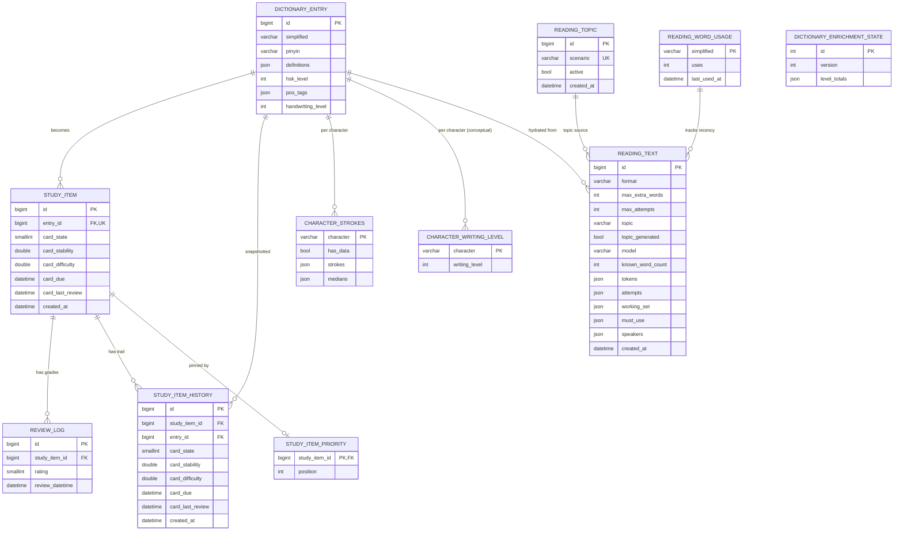
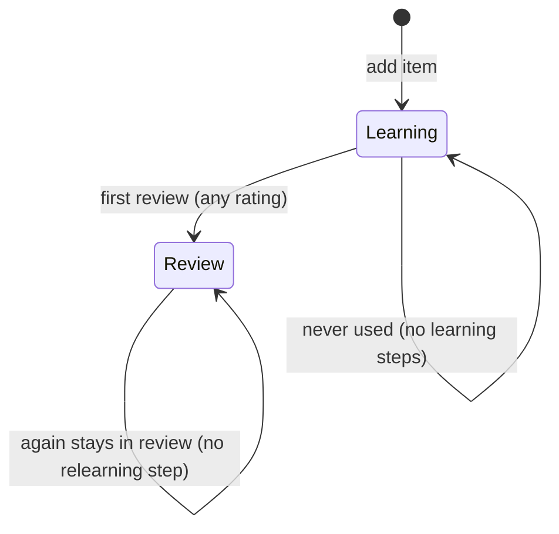

# Data Model

## Entity relationship diagram

> Some edges are conceptual, not foreign keys: `reading_text` references `reading_topic` by topic text, `reading_word_usage` is keyed by simplified word text, and `character_strokes`/`character_writing_level` are keyed by character. The hard FKs are `study_item -> dictionary_entry`, `review_log/study_item_history/study_item_priority -> study_item`, and `study_item_history -> dictionary_entry`.

## Tables

### `dictionary_entry`

Bundled lexicon, populated from CC-CEDICT and enriched with the official HSK 3.0 vocabulary level, community POS tags and the derived handwriting level. Simplified only; traditional forms are dropped.

- `simplified` and `pinyin` are indexed for search and exact matching.
- `pinyin` is normalized at import: lowercase, `ü` written as `v` (`lv4 xing2`).
- `hsk_level` (the word's vocabulary level), `pos_tags` and `handwriting_level` are stamped by the versioned enrichment pass; the same values apply to every row sharing a `simplified`.
- `hsk_level` is the **vocabulary level** from the official HSK 3.0 word list (11,092 words): `1`-`6`, or `7` for the single 7-9 band. A word outside the official list is `NULL` — the old HSK 2.0 fallback is gone.
- `pos_tags` are the community dataset's ICTCLAS tags, joined by simplified form; the reading engine samples PERSON and PLACE words from them.
- `handwriting_level` is derived as the maximum writing level among the word's characters that have one, or null when no character does. It is stored so the study filter and related ordering can use it, while the card can still show the per-character levels.
- A hanzi can have several rows (multiple readings); each is a distinct entry.

### `character_writing_level`

The character-level store of the official HSK 3.0 handwriting list: one row per character expected to be written by hand. `character` is the primary key; `writing_level` is normalized to 1-6 with the single 7-9 band stored as `7`.

- A character outside the table has no writing level; a word's `handwriting_level` ignores those characters.
- Filled by the versioned enrichment pass and created by migration `0008_handwriting_levels`; the word-level `handwriting_level` is derived from it in the same pass.

### `dictionary_enrichment_state`

The single-row marker recording which enrichment version last stamped `dictionary_entry`. `id` is always `1` — the pass upserts the row, so the table holds one version for the whole dictionary.

- The row is absent until the pass first runs; the pass skips while the stored `version` matches the code's.
- Advancing the version re-runs the pass, updating `dictionary_entry` rows in place so row ids, study items and study history survive and no duplicate rows appear. It also refreshes `character_writing_level` and re-derives every `handwriting_level`.
- A re-run clears every row's level and tags before stamping the current sources, so a word dropped from the official list loses its level.
- `level_totals` records the official word counts per level (`"1"`..`"7"`), so proficiency and coverage divide by the official list's totals, not the dictionary subset; it is `NULL` until a pass records it.
- Created by migration `0007_dictionary_enrich`; `character_writing_level` and `handwriting_level` added by `0008_handwriting_levels`; `level_totals` added by `0009_enrichment_level_totals`.

### `study_item`

One row per dictionary entry the learner has queued; unique on `entry_id`. The FSRS card is flattened into `card_*` columns. `card_due` is indexed for "what is due now".

- `card_state`: `1=Learning`, `2=Review`, `3=Relearning`.
- `card_stability` (days) and `card_difficulty` are FSRS parameters.
- Due times are stored as naive UTC and snapped to the configured timezone's midnight by `DayBoundaryEngine`.

### `review_log`

Append-only grade history: `again | hard | good | easy` mapped to smallints. Newest first when read back (review time, then id). Two indexes serve the derived insights, replacing the old `study_item_id`-only index (migration `0005_insights`):

- `(study_item_id, review_datetime, id, rating)` — covering index for the leech window and the per-item grade list.
- `(rating, review_datetime)` — the Extra Study mistake range.

### `study_item_priority`

One row per pinned study item — **row presence is membership**. `study_item_id` is the primary key and a foreign key to `study_item` with `ON DELETE CASCADE`; `position` is a signed integer indexed for the min/max edge reads.

- Push-back is `max + 1`, push-front is `min - 1`, an empty queue starts at `0`. The min/max read and the write share one transaction with a locking read.
- No renumbering, insert-between or drag reorder; there is no unique constraint on `position`, so a duplicate from a write race still orders deterministically by position then id.
- Priority is learning-only. A review that moves a card from `learning` to `review` deletes its row in the same transaction.
- `position` is an opaque display-ordering key — never rendered raw.

### `study_item_history`

Append-only snapshot trail of a study item's card state, written on creation and after every change. Powers item-level charts and the global learning-to-review transition list.

### `character_strokes`

Per-character cache of Hanzi Writer stroke paths. `has_data=false` rows are a negative cache so a missing character is not repeatedly fetched upstream.

### `reading_text`

One row per generated reading. Stores the fully resolved token stream, the generation attempt trail, the offered working set, must-use anchors, dialogue speakers, and token usage. Saved text is immutable history; hydration against the current dictionary only happens on list responses.

### `reading_topic`

Curated scenario pool drawn when the user leaves the topic blank. `active=0` keeps a scenario in the list but out of the draw. Migration `0003` seeds 36 starter scenarios.

### `reading_word_usage`

Per-word use counters (`uses`, `last_used_at`) that feed the recency-biased sampling of the working set. Dialogue speakers are tracked under a `speaker:` key prefix to avoid colliding with vocabulary.

## Derived insights

The insight rules have no columns and no write path of their own:

- **Leech** — an item is a leech when three or more of its ten most recent `review_log` entries carry `again`. The window is the last `min(10, n)` entries, ordered by review time then id descending, and every card state is evaluated. The flag is recomputed on every read, so a good streak that pushes failures out of the window clears it with nothing to reset. The read is one batched windowed aggregate for a whole page of items.
- **Recent Mistakes** — an `again` grade inside the requested instant range on an item whose current `card_state` is `review` or `relearning`, deduped per item and ordered by most recent failure.
- **Recently Learned** — a `study_item_history` row whose state moved `learning -> review` with a `created_at` inside the range, newest transition first. The lag that finds the transition runs over the whole trail; the date predicate is applied to the transition row afterwards, so a graduation whose previous row predates the range is still found.

Practice grades are never written to `review_log`, so they can never enter any window or bucket.

## FSRS scheduling model

The backend wraps `py-fsrs` at the `srs/` boundary and mirrors its card/rating shapes in `usecase/srs/model.py`.

Design choices:

- **No learning or relearning steps**: the first review schedules days out, and an "again" in Review keeps the card in Review instead of dropping it to a relearning sub-state.
- **Day boundary**: every `due` is rounded down to midnight in `STUDY_TIMEZONE`, so a whole day's cards become due at once. This favors a once-a-day habit over per-hour precision.
- **Conflict rule**: grading a card before its `due` returns `409` and writes nothing, so a double-submit can never advance a card twice.

## Time handling

- Domain times are timezone-aware UTC; persistence strips `tzinfo` because MySQL has no timezone.
- All "now" reads go through `IClock` so tests can freeze time.
- Date rendering in the UI converts back to the learner's local timezone.
